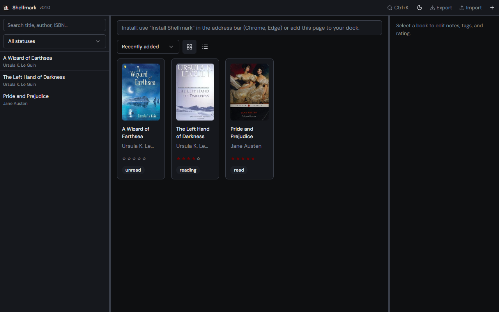
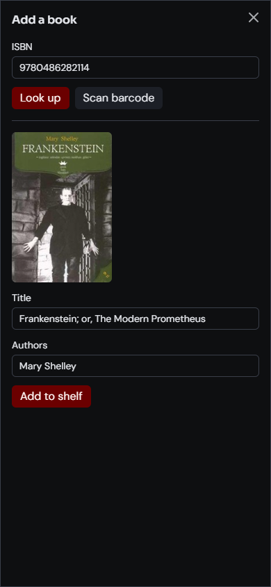

# Shelfmark

A personal bookshelf. Scan an ISBN or type one in, and the catalog stays on this device.



## Contents

- [Screens](#screens)
- [Dev](#dev)
- [Desktop](#desktop-tauri)
- [Mobile](#mobile-capacitor)
- [Features](#features)
- [Install by platform](#install-by-platform)
- [Deploy to Vercel](#deploy-to-vercel)
- [Book lookup](#book-lookup-free-apis)
- [Stack](#stack)
- [Data privacy](#data-privacy)

## Screens

The shelf shot is 1280×800. The add-book shot is 390×844.

### Shelf


Each book shows its cover, author, rating, and whether it is unread, reading, or read. Search and the status filter sit beside the grid.

### Add a book



Type an ISBN or scan a barcode. Lookup fills the title, the authors, and the cover. Add to shelf stores the book on this device.

## Dev

Needs Node.js 22+.

```bash
npm install
npm run dev        # http://localhost:5173
npm run build      # production PWA → dist/
npm run preview    # preview the build
npm test           # Vitest, single run
npm run check      # lint + typecheck + test + build (what CI runs)
```

## Desktop (Tauri)

**Prerequisites:** [Rust](https://rustup.rs/), Node.js 22+, WebView2 (Windows 10/11)

```powershell
npm run tauri:dev      # native window + Vite dev server
npm run tauri:build    # installer (NSIS on Windows)
npm run desktop:shortcut   # Shelfmark.lnk in Desktop\LibraryApps
```

**Windows installer:** `src-tauri/target/release/bundle/nsis/Shelfmark_*_x64-setup.exe` (creates Desktop + Start Menu shortcuts on install).

Set `SHELFMARK_URL=https://your-app.vercel.app` before `desktop:shortcut` to point the browser fallback at production.

## Mobile (Capacitor)

See [MOBILE.md](MOBILE.md).

```bash
npm run build:mobile
npm run cap:sync
npm run cap:android    # or cap:ios on Mac
```

## Features

- Scan ISBN barcodes (native BarcodeDetector + ZXing fallback; **Capture & scan** on desktop)
- Manual ISBN entry — queries Open Library and Google Books in parallel, merges the best result
- Responsive bookshelf grid with cover images
- Book detail view with personal notes
- Search by title, author, or ISBN
- Export / import your library as JSON (import checks and cleans every record; files over 50 MB are refused)
- PWA for web and Huawei; offline shell after install

## Install by platform

| Platform | How to install |
|----------|----------------|
| **iOS** | Safari → Share → **Add to Home Screen**, or build with `npm run cap:ios` (Mac) |
| **Android** | `npm run cap:android` or Chrome → **Install app** |
| **Huawei** | Huawei Browser → **Add to shortcut**; or sideload Android APK |
| **macOS** | `npm run tauri:build` on Mac → `.dmg`, or Chrome **Install** / Add to Dock |
| **Windows** | `npm run tauri:build` → run NSIS installer, or `npm run desktop:shortcut` |
| **Linux** | `npm run tauri:build` on Linux → `.deb` / AppImage |
| **Web** | Deploy `dist/` to HTTPS (Vercel) |

**Camera scanning** needs HTTPS (or `localhost`). On desktop webcam, use **Capture & scan** or type the ISBN.

## Deploy to Vercel

1. Push this repo to GitHub
2. Import in [Vercel](https://vercel.com)
3. Build: `npm run build` · Output: `dist`
4. **Recommended for regional books:** add **`VITE_GOOGLE_BOOKS_API_KEY`** in Environment Variables — free from [Google Cloud Console](https://console.cloud.google.com/) (enable Books API). Without it, Google lookups often fail; Open Library misses many non-English titles.
5. **Restrict the key** in Google Cloud → Credentials → your API key → **Application restrictions → HTTP referrers**, and allow only your production domain(s) (e.g. `https://your-app.vercel.app/*`). Never leave a browser-exposed Books key unrestricted.

## Book lookup (free APIs)

Shelfmark queries these sources **in parallel** and merges the richest result:

| Source | Cost | Notes |
|--------|------|-------|
| [Google Books](https://developers.google.com/books) | Free with API key (~1k/day) | **Best for regional/commercial titles.** Set `VITE_GOOGLE_BOOKS_API_KEY` and restrict it by HTTP referrer (see Deploy). |
| [Open Library](https://openlibrary.org/dev/docs/api/books) | Free, no key | Good for well-catalogued English titles |

**Why not [isbnsearch.org](https://isbnsearch.org)?** It has no public API and shows a reCAPTCHA challenge to server/automated requests (including Vercel). Scraping it cannot work reliably in production — only in a normal browser session.

## Stack

React + Vite · Dexie · Open Library / Google Books · @zxing/browser · vite-plugin-pwa · Tauri 2 · Capacitor 7

## Data privacy

Your library is stored locally in the browser or app WebView. No account, no server database. Use **Export** in the top bar (or **Export library** in the command palette) regularly.
